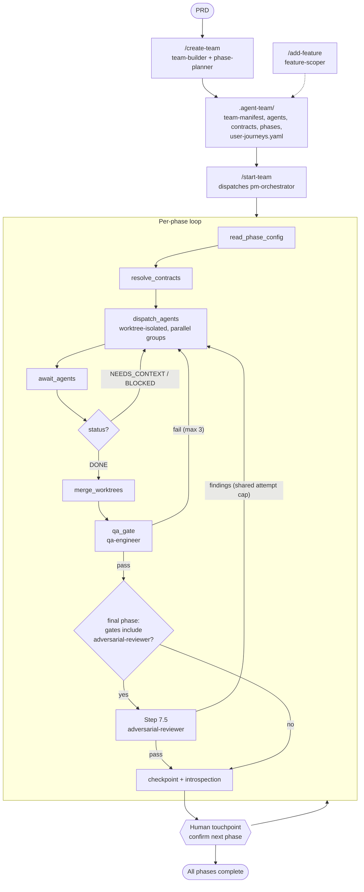
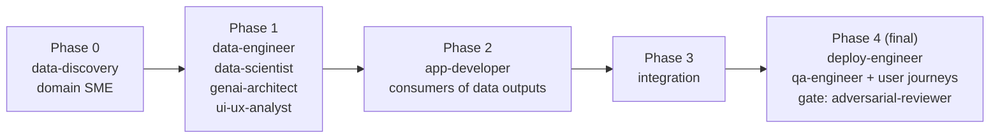

# agent-team

A Claude Code plugin that turns a PRD into a team of AI agents and runs them in phases to build and deploy a Databricks application. Quality gates (functional QA, then an independent adversarial review) sit between build and delivery.

Version: 0.2.0

> **Looking for the UI/UX loop, `/improve-ux`, or the main-session orchestrator?** Those live on the [`databricks-team`](https://github.com/jesusr-db/agent_team/tree/databricks-team) branch (v0.3.0), which has its own README and a fuller `docs/workflow.md`. This page describes `main`.

## Commands

| Command | Purpose |
|---|---|
| `/create-team <prd>` | Analyze a PRD, select agents by capability, define contracts and phases, and write `.agent-team/`. |
| `/start-team` | Execute the plan with phased dispatch and checkpoint recovery. Supports `--phase N`, `--agent <name>`, `--dry-run`. |
| `/add-feature <description>` | Scope an incremental feature to only the agents it needs and extend the existing config. |

## Workflow



### Phase structure



Only the phases an app needs are created; `/create-team` collapses empty ones.

## How it works

1. **Team assembly.** `team-builder` maps PRD capabilities to agent templates, derives user journeys (`user-journeys.yaml`) for app teams, and `phase-planner` orders agents into phases.
2. **Contracts.** Every producer-to-consumer edge has a YAML contract (`lib/contract-schema.yaml`), so agents code against agreed shapes rather than live artifacts.
3. **Phased execution.** The orchestrator dispatches each phase's agents in parallel, each in its own git worktree, then merges, runs QA, and checkpoints to `.agent-team/status/progress.yaml` so a run can resume after interruption.
4. **Gates.** `qa-engineer` runs progressive checks each phase; in the final phase it also drives the deployed app through the user journeys (`app-validation-loop`). `adversarial-reviewer` then tries to falsify the build, read-only, from the spec, contracts and built artifacts only.
5. **Learning.** After each phase the orchestrator writes introspection notes into the project's `CLAUDE.md`.

## Agents

| Agent | Model | Typical phase | Description |
|---|---|---|---|
| `pm-orchestrator` | opus | all | Dispatches workers, merges worktrees, runs the QA and adversarial gates, checkpoints progress, escalates blockers. |
| Domain SME (generated) | haiku | 0 | Researches the domain; writes `domain-playbook.md`, `data-requirements.yaml`, `success-criteria.yaml`. |
| `data-discovery` | sonnet | 0 | Profiles source data: schemas, samples, distributions, quality flags. |
| `data-engineer` | sonnet | 1 | Builds ingestion and transformation pipelines (Spark Declarative Pipelines, Unity Catalog, Auto Loader). |
| `data-scientist` | sonnet | 1-2 | Trains, registers and serves ML models with MLflow and Model Serving. |
| `genai-architect` | opus | 1-2 | Designs RAG, Vector Search, embedding, prompt and model-selection architecture. |
| `ui-ux-analyst` | sonnet | 1 | Designs workflows, wireframes and the component contract. |
| `app-developer` | sonnet | 2-3 | Builds the FastAPI backend and React/TypeScript frontend for Databricks Apps. |
| `deploy-engineer` | sonnet | final | Finalizes the Databricks Asset Bundle config and deploys. |
| `qa-engineer` | sonnet | every phase | Progressive QA checks; in the final phase drives user journeys against the deployed app. |
| `adversarial-reviewer` | opus | final (gate) | Independent, read-only red team that tries to falsify the build. |

Models are the `model:` line in each agent's definition under `agents/`.

## Known limitation on this branch

`/start-team` dispatches `pm-orchestrator` as a subagent, and the harness supports only one level of subagent fan-out, so the workers it spawns may not wire up. The fix (orchestrator runs as a skill in the main session) is on [`databricks-team`](https://github.com/jesusr-db/agent_team/tree/databricks-team).

## Repository layout

```
agents/       registered worker agents
commands/     /create-team, /start-team, /add-feature
skills/       team-builder, phase-planner, feature-scoper, data-analyzer, app-validation-loop
lib/          schemas: contracts, journeys, adversarial findings
templates/    core agent templates and meta generators
docs/         specs and plans
test/         sample PRDs and add-feature test
```

## Prerequisites

- The `ui-ux-pro-max` skill (external marketplace skill) for `ui-ux-analyst`.
- Databricks CLI and an authenticated workspace for deploy and validation.
