# agent-team

A Claude Code plugin that turns a PRD into a team of AI agents and runs them in phases to build and deploy a Databricks application. Quality gates (functional QA, then an independent adversarial review) sit between build and delivery.

Version: 0.3.1 (includes the orchestrator-at-root fix and the UI/UX loop).

## Commands

| Command | Purpose |
|---|---|
| `/create-team <prd>` | Analyze a PRD, select agents by capability, define contracts and phases, and write `.agent-team/`. |
| `/start-team` | Execute the plan. Loads the `pm-orchestrator` skill in the main session. Supports `--phase N` to restart from a phase. |
| `/add-feature <description>` | Scope an incremental feature to only the agents it needs and extend the existing config. |
| `/improve-ux <direction>` | UX/UI-focused pass on an existing app: audit the rendered UI, redesign, rebuild, critic gate. |

## Workflow



Iteration loops (QA fixes, the UX gate, journey fixes before redeploy, adversarial rounds, `/improve-ux`) are drawn as sequence diagrams in [docs/workflow.md](docs/workflow.md). Every loop shares a 3-attempt cap per phase, then escalates to a human.



## How it works

1. **Team assembly.** `team-builder` maps PRD capabilities to agent templates, derives user journeys (`user-journeys.yaml`) for app teams, and `phase-planner` orders agents into phases.
2. **Contracts.** Every producer-to-consumer edge has a YAML contract (`lib/contract-schema.yaml`) so agents code against agreed shapes, not live artifacts.
3. **Phased execution.** The orchestrator dispatches each phase's agents in parallel, each in its own git worktree, then merges, runs QA, and checkpoints. Progress is recorded in `.agent-team/status/progress.yaml` so a run can resume after interruption.
4. **Gates.** `qa-engineer` runs progressive checks each phase; in the final phase it also drives the deployed app through the user journeys (`app-validation-loop`). When the team has a UI, `ux-critic` reviews the rendered app before deploy (see below). `adversarial-reviewer` then tries to falsify the build, read-only, from the spec, contracts and artifacts only.
5. **Learning.** After each phase the orchestrator writes introspection notes into the project's `CLAUDE.md`.

See [docs/workflow.md](docs/workflow.md) for all six sequence diagrams.

## Adversarial review (batched probes)

The `adversarial-reviewer` works in up to 3 **rounds**. Each round it writes batches of probes, runs each batch once, reads the structured results, and uses them to write a more targeted next round. Batches: **data** (a one-time notebook/SQL run; scratch schema for any write probe), **http** (`lib/run_http_probes.py`; mutating requests only against the local app, GET-only against the deployed one) and **static** (grep/AST over the repo). Probes are saved under `.agent-team/review/round-K/` with stable ids, findings cite a `probe_id`, and after a fix only the probes behind prior findings are re-run plus one regression round. A probe that errors never counts as a pass. See `lib/adversarial-probe-schema.yaml`.

## UI/UX loop

For teams with `ui-ux-analyst`:

1. The domain SME writes `ux-brief.yaml` (personas, decisions and cadence, vocabulary, data density, trust needs).
2. `ui-ux-analyst` designs from the brief using whichever of these skills are installed: `databricks-app-design`, `ui-ux-pro-max`, `dataviz` (taste skills only for marketing-style apps). It writes wireframes, the component contract, and `ui-design-spec.yaml` (tokens, per-screen loading/empty/error/partial states, a11y targets, viewports).
3. `app-developer` builds the app and records `run_command` and `health_url`.
4. After QA and before deploy, the `ux-critic` gate starts the app locally, drives every screen at each viewport with Playwright, and judges the **rendered** UI on six dimensions (brief fit, spec fidelity, states, data honesty, accessibility, runtime health; plus Genie trust checks where relevant). Findings go to `ux-findings-phase-N.yaml`.
5. Blocker and major findings are fixed in a loop: spec problems go to `ui-ux-analyst` first, then `app-developer`; the critic re-checks. The loop shares the phase's 3-attempt cap and escalates early if two attempts return the same findings. If the app cannot start locally the gate reports `BLOCKED` and asks you, rather than passing.

**`/improve-ux` (existing apps).** Like `/add-feature` but focused on UI: `<direction>` is free text or a path to a file (e.g. "make the overview denser and add empty states"; add `--human checkpoint|async|off`, `--no-deploy`). The `ux-scoper` skill snapshots the app, derives a lightweight `ux-brief.yaml` if none exists (marked `derived: true`), and tags `ux-focus/<slug>` as a rollback point. Phase 0 runs the critic in **audit mode** on the app as it is today; you review the findings at the phase boundary and can add comments to `ux-feedback.md`. Then `ui-ux-analyst` redesigns, `app-developer` rebuilds only the affected pages, and the normal critic gate and fix loop run. Once the design is approved (by you, or by the critic gate if you don't respond), `deploy-engineer` redeploys and `qa-engineer` runs the user journeys against the deployed app; use `--no-deploy` to stop before that.

**Journey fixes are validated before redeploy.** When deployed-app journeys fail, the fix is merged, the app is started locally, and *all* journeys are re-run against it (plus a critic regression pass if the frontend changed). Only when every journey passes locally does `deploy-engineer` redeploy, followed by one confirming deployed run. Journeys that can't be verified locally (deployed-only identity, or a pipeline/model/serving fix) are flagged `NOT_LOCALLY_VERIFIABLE` and need your approval before a redeploy.

**Human review (optional).** In `team-manifest.yaml`:

```yaml
ux_review:
  human: async      # off | async | checkpoint
  wait_minutes: 5
```

With `async` (default), after the critic's first attempt the orchestrator gives you the local app link and a `ux-feedback.md` file. Save comments there within 5 minutes and they become top-priority findings; if you don't, it continues with the agent's findings. `checkpoint` stops and waits for you; `off` is agent-only.

## Agents

| Agent | Model | Typical phase | Description |
|---|---|---|---|
| `pm-orchestrator` (skill) | main session (Opus recommended) | all | Runs in the main session. Dispatches workers, merges worktrees, runs the QA, UX and adversarial gates, checkpoints progress, escalates blockers. |
| Domain SME (generated) | haiku | 0 | Researches the domain; writes `domain-playbook.md`, `data-requirements.yaml`, `success-criteria.yaml`, and `ux-brief.yaml` for app teams. |
| `data-discovery` | haiku | 0 | Profiles source data: schemas, samples, distributions, quality flags (`data-profile.yaml`, data dictionary). |
| `data-engineer` | haiku | 1 | Builds ingestion and transformation pipelines (Spark Declarative Pipelines, Unity Catalog, Auto Loader). |
| `data-scientist` | haiku | 1-2 | Trains, registers and serves ML models with MLflow and Model Serving. |
| `genai-architect` | opus | 1-2 | Designs RAG, Vector Search, embedding, prompt and model-selection architecture. |
| `ui-ux-analyst` | sonnet | 1 | Designs workflows, wireframes, the component contract and the design spec, using the installed UI skills. |
| `app-developer` | sonnet | 2-3 | Builds the FastAPI backend and React/TypeScript frontend for Databricks Apps. |
| `qa-engineer` | sonnet | every phase | Progressive QA checks; in the final phase drives user journeys against the app. |
| `ux-critic` | sonnet | build phase (gate) | Starts the app locally, drives each screen, and judges the rendered UI against the brief and design spec; also audits existing apps for `/improve-ux`. |
| `deploy-engineer` | haiku | final | Finalizes the Databricks Asset Bundle config and deploys. |
| `adversarial-reviewer` | opus | final (gate) | Independent red team that tries to falsify the build from the spec, contracts and artifacts, working in rounds of batched probes. |

Model values are the `model:` line in each agent's definition (`agents/*.md`, mirrored in `templates/core/*.yaml`). Change a line there to re-tier an agent.

Registered agents live in `agents/`; their templates are in `templates/core/`, and generators for SMEs and specialists are in `templates/meta/`.

## Orchestration constraint

The harness allows one level of subagent fan-out. `pm-orchestrator` is therefore a **skill** run in the main session, not a subagent, and no worker agent may dispatch further agents.

## Repository layout

```
agents/       registered worker agents
commands/     /create-team, /start-team, /add-feature
skills/       team-builder, phase-planner, pm-orchestrator, feature-scoper,
              data-analyzer, app-validation-loop
lib/          schemas: contracts, journeys, adversarial findings, UX findings, UI design spec
templates/    core agent templates and meta generators
docs/         workflow diagrams, specs, plans
test/         sample PRDs and add-feature test
```

## Prerequisites

- The `ui-ux-pro-max` skill (external marketplace skill) for `ui-ux-analyst`.
- Databricks CLI and an authenticated workspace for deploy and validation.

## Status

The UI/UX loop is implemented in this version but has not yet been exercised on a real `/start-team` run.

## Roadmap

- **Validate the UI/UX loop** end to end on a real build (the first run will show whether local startup and the 5-minute human wait behave as designed).
- **Brand picker** (planned, separate from the UI/UX loop): let a user choose a brand theme for generated apps, with three initial options: **Domino's Pizza**, **Databricks**, and **Casey's Convenience Stores**. Each brand would supply design tokens (palette, typography, logo usage) that the design and critique steps apply. The `brandkit` skill is intentionally not part of this effort. Open question: whether the picker is a build-time choice made when the team is created, or a runtime theme switcher inside the generated app.
