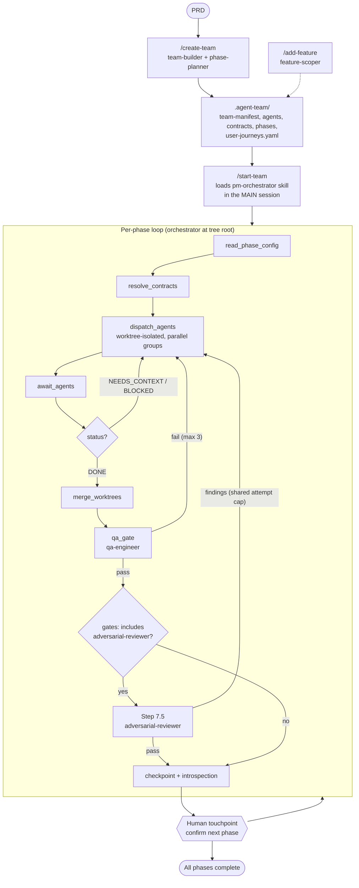
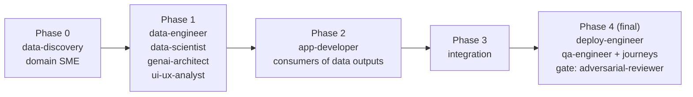
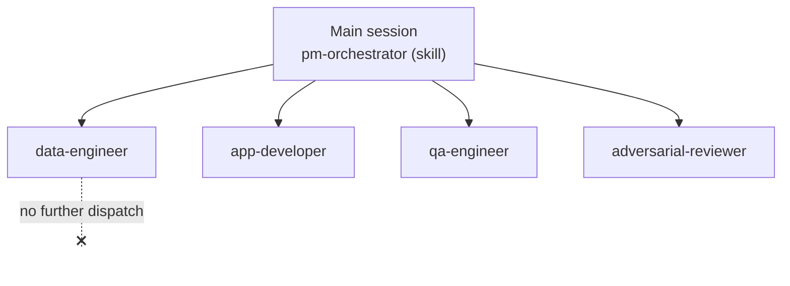
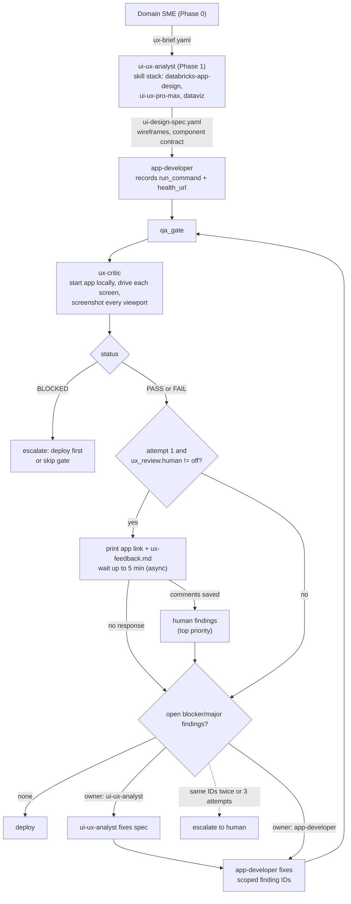
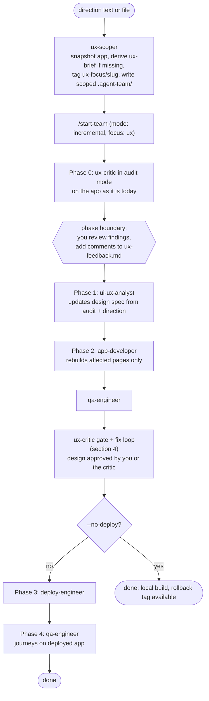

# agent-team Workflow

Diagrams render on GitHub (Mermaid). They describe the plugin as it exists on this branch, including the UI/UX loop (section 4).

## 1. End-to-end flow

## 2. Phase structure

## 3. Orchestration constraint

The harness supports one level of subagent fan-out. The orchestrator therefore runs as a skill in the main session, and workers never spawn workers.

## 4. UI/UX loop

Every box is a one-level subagent dispatched by the orchestrator in the main session; the loop is orchestrator-driven, not nested.

## 5. `/improve-ux` (existing app)

