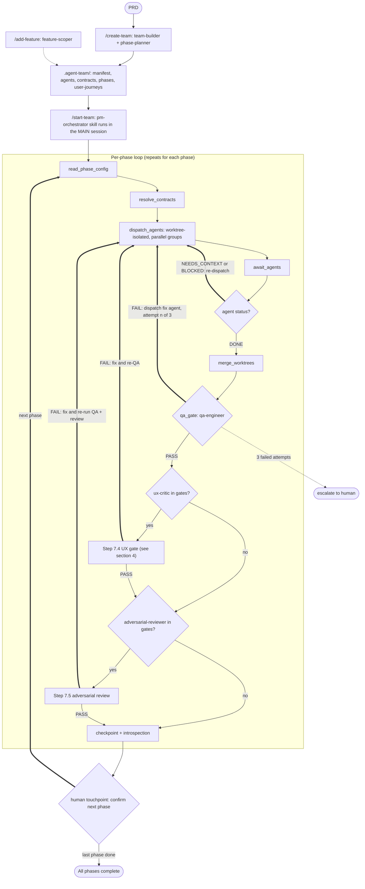
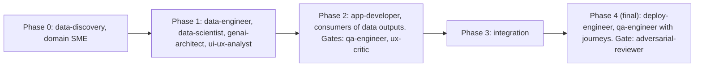
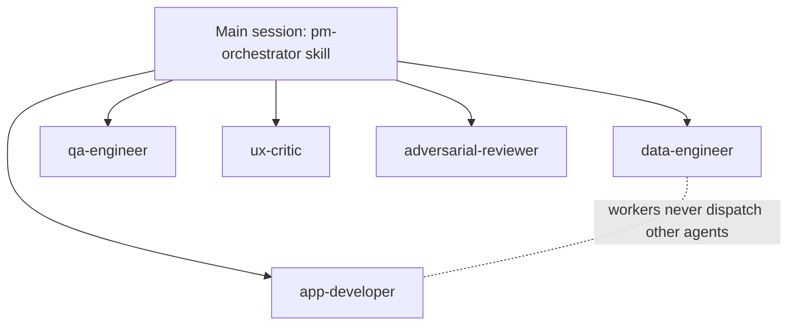
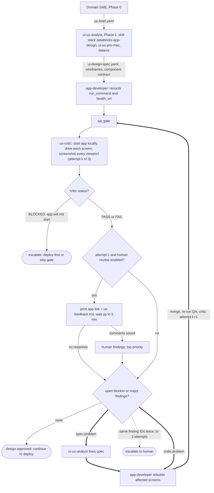
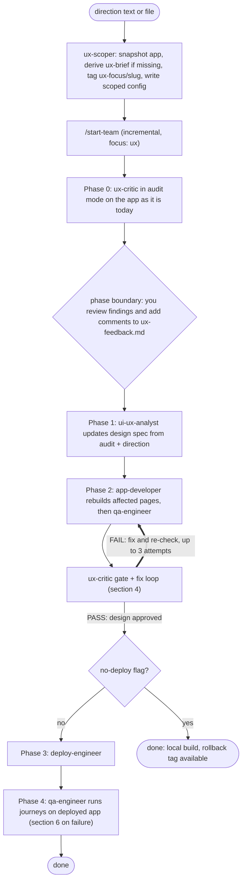
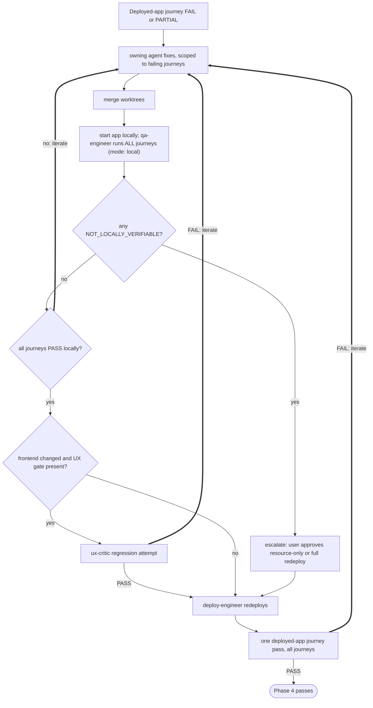

# agent-team Workflow

Diagrams render on GitHub (Mermaid). They describe the plugin as it exists on this branch, including the UI/UX loop. Thick arrows (`==>`) mark **iteration loops**; every loop shares the phase's 3-attempt cap, then escalates to a human.

## 1. End-to-end flow

## 2. Phase structure

## 3. Orchestration constraint

The harness supports one level of subagent fan-out. The orchestrator therefore runs as a skill in the main session, and workers never spawn workers.

## 4. UI/UX loop

## 5. `/improve-ux` (existing app)

## 6. Journey failure handling (fix and validate before redeploy)

## 7. Agents and models

| Agent | Model | Phase | Description |
|---|---|---|---|
| `pm-orchestrator` (skill) | main session (Opus recommended) | all | Runs in the main session. Dispatches workers, merges worktrees, runs the QA, UX and adversarial gates, checkpoints progress, escalates blockers. |
| Domain SME (generated) | haiku | 0 | Researches the domain; writes `domain-playbook.md`, `data-requirements.yaml`, `success-criteria.yaml`, and `ux-brief.yaml` for app teams. |
| `data-discovery` | haiku | 0 | Profiles source data: schemas, samples, distributions, quality flags (`data-profile.yaml`, data dictionary). |
| `data-engineer` | haiku | 1 | Builds ingestion and transformation pipelines (Spark Declarative Pipelines, Unity Catalog, Auto Loader). |
| `data-scientist` | haiku | 1-2 | Trains, registers and serves ML models with MLflow and Model Serving. |
| `genai-architect` | opus | 1-2 | Designs RAG, Vector Search, embedding, prompt and model-selection architecture. |
| `ui-ux-analyst` | sonnet | 1 | Designs workflows, wireframes, the component contract and the design spec, using the installed UI skills. |
| `app-developer` | sonnet | 2-3 | Builds the FastAPI backend and React/TypeScript frontend for Databricks Apps. |
| `qa-engineer` | sonnet | every phase | Progressive QA checks; in the final phase drives user journeys against the app. |
| `ux-critic` | sonnet | build phase (gate) | Starts the app locally, drives each screen, and judges the rendered UI against the brief and design spec; also audits existing apps for `/improve-ux`. |
| `deploy-engineer` | haiku | final | Finalizes the Databricks Asset Bundle config and deploys. |
| `adversarial-reviewer` | opus | final (gate) | Independent, read-only red team that tries to falsify the build from the spec, contracts and artifacts. |

Model values are the `model:` line in each agent's definition (`agents/*.md`, mirrored in `templates/core/*.yaml`). Change a line there to re-tier an agent.
