# agent-team Workflow

Sequence diagrams of the plugin on this branch, drawn with the `diagram-design` skill. Lifelines are the phases' agents and gates; a **LOOP** frame marks an iteration, and every loop shares the phase's 3-attempt cap before it escalates to a human. Sources are the self-contained HTML files in [`diagrams/`](diagrams/); regenerate them with `python3 docs/diagrams/build_sequence_diagrams.py`, then export each to SVG.

## 1. Phases, agents and gates

Phase 0 gathers data and domain context, then pauses for your confirmation. Phases 1-3 loop builders and gates until the gates pass. Phase 4 deploys and runs journeys and the red team. The orchestrator runs in your main session; every other agent is a one-level subagent it dispatches.

## 2. Phase execution and the QA fix loop

On a QA failure the owning agent is re-dispatched, scoped to the failing checks, and QA re-runs. After three failures the orchestrator asks you.

## 3. UX gate loop with optional human review

The `ux-critic` reviews the rendered app. On attempt 1 you get the local link and up to 5 minutes to comment (`ux_review.human: async`); with no reply the agent's findings stand. Spec problems go to `ui-ux-analyst` before `app-developer` rebuilds.

## 4. Fix and validate journeys before redeploy

A failing deployed journey is fixed, then every journey is re-run against the locally started app (plus a UX regression check if the frontend changed). Only then does `deploy-engineer` redeploy, followed by one confirming run. Journeys that cannot run locally need your approval first.

## 5. Adversarial review in rounds of batched probes

The reviewer runs up to three rounds of batched data, HTTP and static probes. After a fix it re-runs only the probes behind earlier findings plus one regression round. Mutating HTTP probes run only against the local app.

## 6. `/improve-ux` on an existing app

The critic audits the app as it is today, you review the audit, the analyst redesigns, the developer rebuilds affected pages, and the gate loops until it passes. Deploy and journey validation then follow as in section 4; `--no-deploy` stops at the approved design.

## 7. Agents and models

| Agent | Model | Phase | Description |
|---|---|---|---|
| `pm-orchestrator` (skill) | main session (Opus recommended) | all | Runs in the main session. Dispatches workers, merges worktrees, runs the QA, UX and adversarial gates, checkpoints progress, escalates blockers. |
| Domain SME (generated) | haiku | 0 | Researches the domain; writes `domain-playbook.md`, `data-requirements.yaml`, `success-criteria.yaml`, and `ux-brief.yaml` for app teams. |
| `data-discovery` | haiku | 0 | Profiles source data: schemas, samples, distributions, quality flags (`data-profile.yaml`, data dictionary). |
| `data-engineer` | haiku | 1 | Builds ingestion and transformation pipelines (Spark Declarative Pipelines, Unity Catalog, Auto Loader). |
| `data-scientist` | haiku | 1-2 | Trains, registers and serves ML models with MLflow and Model Serving. |
| `genai-architect` | opus | 1-2 | Designs RAG, Vector Search, embedding, prompt and model-selection architecture. |
| `ui-ux-analyst` | sonnet | 1 | Designs workflows, wireframes, the component contract and the design spec, using the installed UI skills. |
| `app-developer` | sonnet | 2-3 | Builds the FastAPI backend and React/TypeScript frontend for Databricks Apps. |
| `qa-engineer` | sonnet | every phase | Progressive QA checks; in the final phase drives user journeys against the app. |
| `ux-critic` | sonnet | build phase (gate) | Starts the app locally, drives each screen, and judges the rendered UI against the brief and design spec; also audits existing apps for `/improve-ux`. |
| `deploy-engineer` | haiku | final | Finalizes the Databricks Asset Bundle config and deploys. |
| `adversarial-reviewer` | opus | final (gate) | Independent, read-only red team that tries to falsify the build from the spec, contracts and artifacts. |

Model values are the `model:` line in each agent's definition (`agents/*.md`, mirrored in `templates/core/*.yaml`). Change a line there to re-tier an agent.
